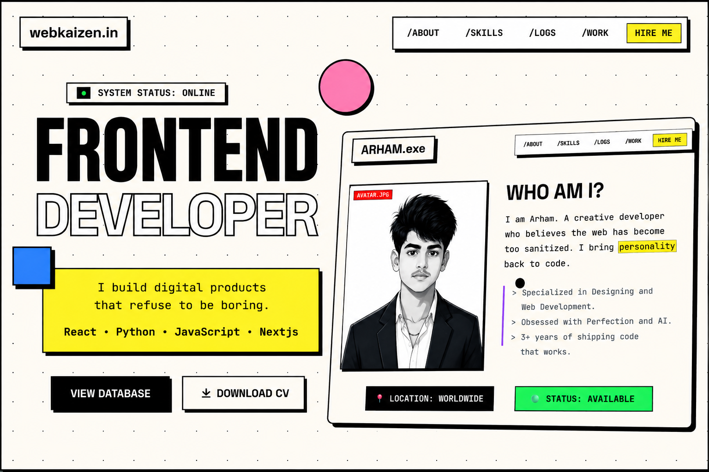

# ARJITKUMAR01 | PORTFOLIO

<p align="center">
  
</p>

```
█████╗ ██████╗      ██╗██╗████████╗
██╔══██╗██╔══██╗     ██║██║╚══██╔══╝
███████║██████╔╝     ██║██║   ██║   
██╔══██║██╔══██╗██   ██║██║   ██║   
██║  ██║██║  ██║╚█████╔╝██║   ██║   
╚═╝  ╚═╝╚═╝  ╚═╝ ╚════╝ ╚═╝   ╚═╝   

>> SYSTEM_STATUS: ONLINE
>> DEVELOPER: ARJIT KUMAR MAHATO
>> SPECIALIZATION: B.TECH CSE (SEMESTER 3)
```

<p align="center">
  
  
  
</p>

---

## ╰┈➤ TECH_STACK

| COMPONENT | TECHNOLOGY | STATUS |
| :--- | :--- | :--- |
| **CORE** | `HTML5` + `Vanilla JavaScript` | [OPTIMIZED] |
| **STYLING** | `Vanilla CSS` + `TailwindCSS` | [CUSTOM_THEME] |
| **LANGUAGES** | `C`, `C++`, `Python`, `Java` | [ACTIVE_DSA] |
| **DESIGN** | `Adobe Photoshop` | [COMMERCIAL & EDITORIAL] |
| **ICONS** | `Remix Icons` | [LINKED] |
| **FONTS** | `Space Grotesk` + `JetBrains Mono` | [GOOGLE_FONTS] |

---

## ╰┈➤ FEATURES_LOG

### 01. NEO-BRUTALIST ARCHITECTURE
> Bold high-contrast visual design with custom retro scanlines, stark black drop shadows (`shadow-hard`), vibrant accents, and smooth scroll transitions.

### 02. CYBER TERMINAL PRELOADER
> Lightweight retro bootloader sequence that simulates core system initializations and smoothly unveils the hero canvas in under 1 second.

### 03. rAF-OPTIMIZED CUSTOM CURSOR
> Decoupled mouse positioning using `requestAnimationFrame` for buttery-smooth 60/120fps tracking. Automatic degradation for touch/mobile devices via `@media (pointer: fine)`.

### 04. DYNAMIC GITHUB INTEGRATION
> Live metrics, contribution graph, and streak counters synced directly with [@Arjitkumar01](https://github.com/Arjitkumar01).

### 05. CREATIVE DESIGN SHOWCASE
> Featuring authentic graphic design projects created in Adobe Photoshop, from commercial sneaker ads to editorial magazine layouts and movie tributes.

### 06. ACCESSIBLE FORM VALIDATION
> Form verification compliant with modern web guidance utilizing `:user-invalid` / `:user-valid` constraints and automatic `aria-invalid` state synchronization.

---

## ╰┈➤ FILE_STRUCTURE

```bash
.
├── Assets/
│   ├── images/          # Project screenshots and Photoshop design showcases
│   ├── Resume/          # Direct CV download (PDF)
│   ├── app.js           # Interactive cursor, reveal observers, preloader logic
│   └── app.css          # Neo-brutalist theme, matrix grid, scrollbars, validation styles
├── index.html           # Main portfolio application
└── README.md            # Documentation
```

---

## ╰┈➤ CONNECT & CONTACT

- **GitHub**: [github.com/Arjitkumar01](https://github.com/Arjitkumar01)
- **LinkedIn**: [Arjit Kumar Mahato](https://www.linkedin.com/in/arjit-kr-mahato-b73a6337b)
- **Email**: [arjitkrmahato@gmail.com](mailto:arjitkrmahato@gmail.com)

---

**© 2026 ARJIT KUMAR MAHATO**
